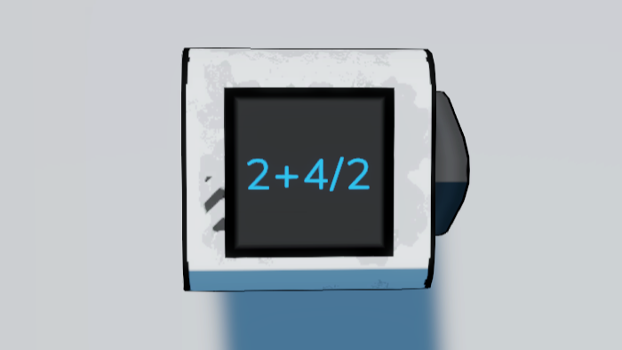

# StellarDrive - Pi Is Delicious
Lets you do math in the constant gate. Among other things it's very usefull to quickly enter multiples of pi.

## Images
The images show what the text looks like before enter is pressed, it displays the calculated value afterwards. This isn't always ideal but it means no custom data is sent, so the server doesn't need the mod.
| Thumbnail (image-1.png)                                                                                                                                            | (image-2.png)                                                                                                                                                      |
| ------------------------------------------------------------------------------------------------------------------------------------------------------------------ | ------------------------------------------------------------------------------------------------------------------------------------------------------------------ |
|  |  |
